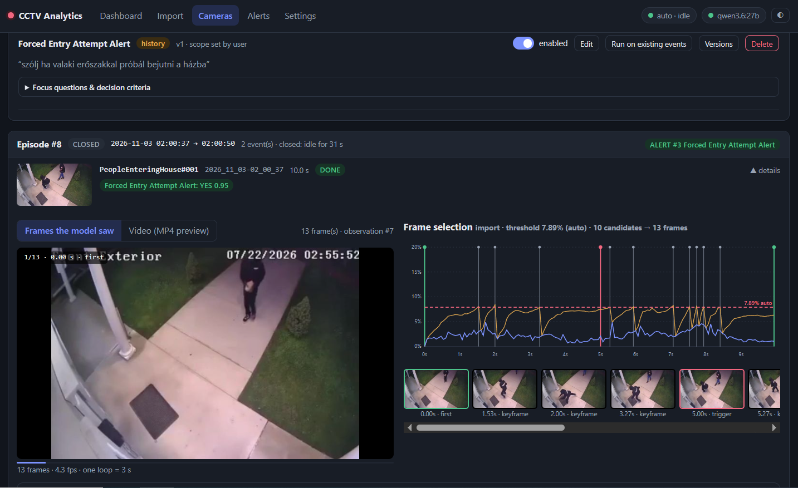
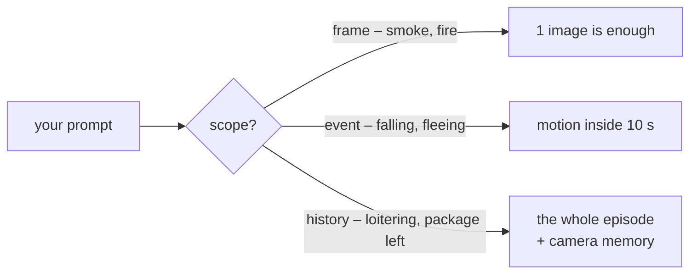

# 🎥 CCTV Adaptive Event Recognition

> **Tell a camera what you care about – in plain words. It watches, thinks, and only taps you on the shoulder when it matters.**

<p align="center"></p>

*"Alert me if someone leaves a package at the door and then walks away."*
*"Alert me if someone loiters in front of the entrance."*
*"Alert me if you see smoke."*

No fixed event list, no rule editor. A local vision-language model (`qwen3.6:27b` on Ollama)
reads your sentence, figures out **how much context it needs** – one frame? ten seconds of
motion? the whole story across several events? – and then judges every camera event against it.

<p align="center"></p>

---

## ⚡ Run it in 60 seconds

```bash
cp .env.example .env          # set OLLAMA_BASE_URL here (needs qwen3.6:27b)
docker compose up --build     # → http://localhost:8000
```

1. **Import** – drop an MP4 on the Import page. It is cut into 10-second camera events; drag
   the slider to pick each trigger frame, drag the dashed line to choose which frames the
   model will see. Hit **Save events**.
2. **Cameras → your camera → Add prompt** – type what you want to be alerted about. The LLM
   proposes a scope and a few focus questions; tweak anything, save.
3. Watch the **Dashboard**: events flow in, the model observes, decides, and alerts pop up
   with the frame that proves it.

Running without Docker: Python 3.14, `pip install -r requirements.txt`, ffmpeg on the PATH (or
`FFMPEG_BIN` / `FFPROBE_BIN` in `.env`), then `uvicorn app.main:app`.

---

## 🧠 How it thinks



**1. Prompt → plan (once).** The LLM turns your sentence into a *scope*, 2–5 *focus
questions* ("Is a package on the ground near the door?") and *decision criteria*. Everything
is editable and versioned.

**2. Event → frames (adaptive).** Uniform sampling misses a package thrown in half a second
and never notices smoke creeping down a wall. So every frame gets a change score – against
the previous frame *and* against the last keyframe – and a hybrid selector picks **5–30
frames** where things actually happen. The threshold calibrates itself per video
(median + 6·MAD (Median Absolute Deviation) of the noise), and you can drag it by hand on the import chart.

**3. Frames → observation (one VLM call).** One call per event answers the focus questions
of *every* prompt on that camera at once, citing frame numbers. Cached, so re-runs are cheap.

**4. Observation → decision (per prompt).**
- *frame / event*: `YES · NO · UNCERTAIN` from this event alone;
- *history*: `YES · PENDING · NO` from **all observations of the episode** (consecutive events
  ≤ 15 s apart) plus the **camera memory** – summaries of earlier episodes. That is how
  "someone took the package delivered five minutes ago" becomes decidable.

**5. Decision → alert.**  The first `YES` → alert with the model's key frame, the reasoning and a
✔/✘/? for every focus question; the prompt then rests for that episode. Still unsure when the
episode ends → **NEEDS_REVIEW** for a human. Nothing found → no alert.

The full state machine: [docs/evaluation_flow.svg](docs/evaluation_flow.svg).

---

## 🎬 The demo – 17 videos, every required case

Import the videos from the test folder (camera id = file name; only `foodDelivery.mp4` and
`FoodRobbery.mp4` go to one camera, **FrontPorch**, the second 5 minutes after the first), then:

> **Don't have test videos?** They are not part of the repository as these files may exceed size limitations - just ask me and
> I'll give you access.

```bash
docker compose exec app python -m scripts.seed_demo     # creates the demo prompts
```

| Case | Camera | Prompt | Expected |
|---|---|---|---|
| One frame is enough | LivingRoomSmoke, CarFireAtGasStation, MetalForgeBlast | smoke / fire / explosion | 🚨 ALERT |
| Motion within 10 s | PursuitAndFall, StairwellEscape, ShopRobbery | falls / flees / armed robbery | 🚨 ALERT |
| Needs several events | WaitingOutside, PackageDeliveryFrontDoor | loitering > 30 s / package left, person leaves | 🚨 ALERT |
| Needs memory of an earlier episode | FrontPorch (2 videos) | someone takes the package delivered earlier | 🚨 ALERT in episode 2 only |
| Not enough information | PeopleEnteringHouse, FedExDeliveryDog, PackageDelivery | break-in? / dog attack? / package left? | 👀 NEEDS_REVIEW |
| Event happens, condition doesn't | WarehouseWorkers, StoreInterior, FoodDeliveryPickup | smoke / armed robbery / package left | Nothing |

The exact prompts and accepted outcomes live in [demo/scenarios.json](demo/scenarios.json).

**First live run (thinking off): 14 / 19 outcomes as expected.** Fire, explosion, fall,
fleeing, robbery, loitering, package left *and* the package stolen five minutes later (camera
memory) all work; the misses – slow smoke, a package thrown at night, a guard read as a gunman,
a misread dog scene – are analysed in [docs/LIVE_RESULTS.md](docs/LIVE_RESULTS.md).

---

## Tests

```bash
docker compose run --rm app pytest tests/unit      # 39 tests, no model, ~10 s
docker compose run --rm app pytest tests/live -v   # real Ollama, thinking off, on your imported demo
```

- **Unit** – splitting and timestamps, numbering, the frame selector (peaks, slow drift,
  limits, manual override), episodes, the alert state machine, read-only `events.db`, the API.
- **Live** – condition analysis plus every demo scenario end to end on the real model, on a
  temporary `analytics.db`; each prompt/episode outcome is checked against the accepted set
  and a markdown report lands in `data/reports/`. Scenarios whose videos are not imported
  are skipped.

---

## Main assumptions

- The **camera system already exists**: its detector produced the events, the import page
  just simulates it. The analytics **only reads** its database (`events.db`) and keeps
  everything else in its own `analytics.db`.
- An **episode** = events of one camera ≤ 15 s apart; it closes on a bigger gap or after
  30 s without new events.
- Each test video is one happening; in production one camera has many episodes – handled.
- Ollama runs outside the container; temperature is fixed at 0.0.
- No RTSP, no Kubernetes, no authentication (it is only PoC).

---

## Where things are

```
app/
  camera_sim/   import: MP4 → 10 s MJPEG events (the simulated camera system, events.db)
  selection/    change signals + hybrid frame selector
  analytics/    engine (episodes, observation, decisions), alerts, worker, analytics.db
  llm/          Ollama client (retries, JSON repair, image auto-fit), output schemas
  prompts/      the system prompts – plain Markdown, readable on the Settings page
  api/          FastAPI routes (REST + SSE)
  web/          plain HTML/CSS/JS pages
demo/           scenarios.json – videos, prompts, accepted outcomes
scripts/        seed_demo.py
tests/          unit/ (no model) · live/ (real model)
docs/           SPEC · DESIGN_NOTES · AI_USAGE · diagrams
```

## 📚 Read more

- [docs/SPEC.md](docs/SPEC.md) – the full functional specification
- [docs/DESIGN_NOTES.md](docs/DESIGN_NOTES.md) – key decisions, alternatives, measurements, what changes in production
- [docs/LIVE_RESULTS.md](docs/LIVE_RESULTS.md) – results of the live demo run, with the misses analysed
- [docs/AI_USAGE.md](docs/AI_USAGE.md) – how AI was used and who decided what
- [docs/architecture.svg](docs/architecture.svg) · [docs/evaluation_flow.svg](docs/evaluation_flow.svg) – diagrams
